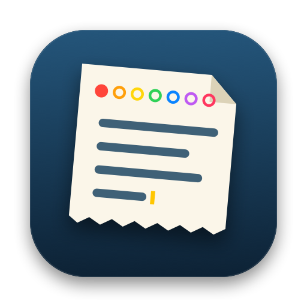

# scrap

A free, open-source scratchpad that lives in your Mac's menu bar. A fixed set of pads (7 by default), plain Markdown files, keyboard-first, themeable. Inspired by Tot, with no paid tier.

- **Pads:** numbered colour dots at the top, `⌘1`–`⌘9` to jump, `⌘K` to search, `⇧⌘⌫` to clear
- **Plain files:** pads are `1.md` … `N.md` in a folder you control, iCloud Drive by default
- **Markdown:** headings, emphasis, links and fenced code are highlighted
- **Themes:** 9 editor themes, each in dark and light
- **CLI:** `scrap add "buy milk"`, `pbpaste | scrap add -p 2`, `scrap show 2`, `scrap list`, `scrap link`
- **Sync-safe:** if sync leaves a conflicting copy of a pad, both versions are kept

Requires macOS 14 or later.

## Install

### Homebrew (builds from source)

    brew tap Anubhavdxt/scrap https://github.com/Anubhavdxt/scrap
    brew install scrap
    scrap link
    open -a Scrap

`scrap link` links the app into `/Applications`. It only ever replaces its own link, never a real `Scrap.app`. Run `scrap unlink` before `brew uninstall scrap` to remove it.

Needs the Xcode Command Line Tools (`xcode-select --install`). Because it is built on your Mac, there is no Gatekeeper warning.

### From source

    git clone https://github.com/Anubhavdxt/scrap.git
    cd scrap && make install

`make install` puts `Scrap.app` in `/Applications` and the CLI at `/usr/local/bin/scrap`. `make uninstall` removes both.

## Use

| | |
|---|---|
| Show or hide | `⌃⌥Space`, or click the menu bar icon |
| Quick switch | `⌘K` |
| Go to pad 1–9 | `⌘1` – `⌘9` |
| Clear pad | `⇧⌘⌫` |
| Settings | the gear, `⌘,`, or right-click the menu bar icon |

Settings has the pad count, theme, and the opening window size in columns × rows, like a terminal.

## Configuration

Optional `~/.config/scrap/config.json`, shared by the app and the CLI:

    { "folder": "~/notes", "pads": 7 }

`scrap add` puts text in the last empty pad, or appends to the last pad if none is empty. Use `-p N` to pick one.

## Development

    swift build
    swift test
    make app && open build/Scrap.app
    make icons   # regenerate the logo assets from scripts/make_icon.swift

Work happens on feature branches and is squash-merged by pull request. See [CONTRIBUTING.md](CONTRIBUTING.md) and [TODO.md](TODO.md).

## License

MIT
